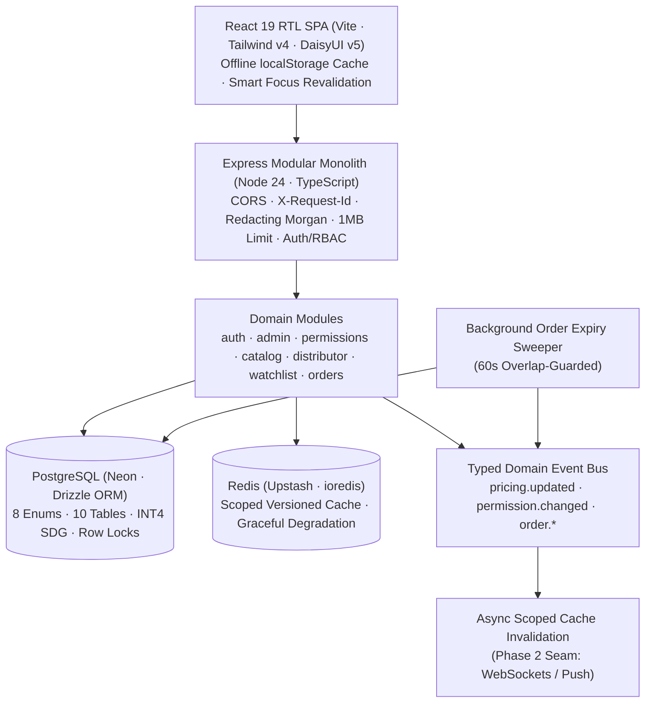

# مقترح المشروع التقني والتجاري: منصة «مدد B2B» (Madad B2B)

**منصة الإمداد الدوائي الذكية وتزامن أسعار الجملة للمنشآت الصيدلانية المرخصة**

* **القطاع:** الرعاية الصحية وسلاسل الإمداد الدوائي (HealthTech / B2B Supply Chain)
* **النطاق الجغرافي المستهدف (المرحلة الأولى):** محلية أمدرمان — ولاية الخرطوم، السودان
* **العملة المعتمدة:** الجنيه السوداني (SDG — حسابات صحيحة دقيقة خالية من الكسور)
* **الحالة الحالية:** إصدار أولي مكتمل وجاهز للتشغيل الحي (Production-Ready MVP)

---

## 1. الملخص التنفيذي

يعاني قطاع الإمداد الدوائي في أمدرمان من فجوة تشغيلية مزدوجة ومكلفة: **تشتت معلومات توفر الأدوية** بين عشرات الموزعين عبر قوائم واتساب وملفات Excel وPDF غير موحدة، و**التقلب السريع في أسعار الجملة** بالجنيه السوداني؛ ما يؤدي إلى بيع الصيدليات لأصنافها بأقل من تكلفة إعادة الشراء (تآكل رأس المال) وإهدار ساعات يومية في الاتصالات الهاتفية للتحقق من التوفر والسعر، في وقت يرفض فيه الموزعون نشر أسعارهم علناً لحماية سياستهم التجارية.

تقدم منصة **«مدد B2B»** حلاً رقمياً مغلقاً وموثوقاً يربط **الصيدليات المرخصة** بـ **موزعي وشركات الأدوية المعتمدة** عبر كتالوج موحّد قابل للبحث بالاسم التجاري والمادة الفعالة والشركة المنتجة، مع **نظام صارم لحجب أسعار الجملة (`B2B Price Gating`)** لا يكشف السعر إلا بعد موافقة الموزّع لكل صيدلية. كما توفر المنصة للصيدلي **راداراً ذكياً للأسعار وحاسبة لهامش الربح** لحماية سعر الرف، وتمنح الموزّع أدوات **تسعير جماعي ذري (`ACID`) واستيراد سريع لقوائم الأسعار العربية** مع نظام طلبيات محصّن ضد تضارب الأسعار وانقطاع الإنترنت.

---

## 2. تحليل المشكلة الميدانية (واقع سوق أمدرمان)

بُني تصميم «مدد B2B» على بحث ميداني مباشر ومقابلات مع صيدليات عاملة في أمدرمان (من بينها صيدلية يولاند) وشركات توزيع دوائي، وكشف البحث عن أربع نقاط ألم جوهرية تتسبب في خسائر يومية قابلة للقياس:

| نقطة الألم الميدانية | الوضع الراهن (Workarounds) | الأثر المالي والتشغيلي |
| --- | --- | --- |
| **تشتت التوفر والبدائل** | قوائم نصية عبر مجموعات واتساب، ملفات PDF وExcel غير مهيكلة، واتصالات هاتفية متكررة | إهدار ساعات يومياً في البحث عن الصنف أو بديله بالمادة الفعالة، وفقدان مبيعات عند انقطاع الصنف |
| **صدمات تسعير الجملة** | تغير أسعار الموزعين بصورة مفاجئة دون إشعار مركزي يربط التغيير بسعر الرف | بيع الصيدلية للمخزون بسعر قديم ثم اكتشاف ارتفاع سعر الجملة عند إعادة الطلب (تآكل رأس المال) |
| **سرية الأسعار التجارية** | امتناع الموزعين عن نشر قوائم الأسعار للعامة أو المنافسين | فشل المنصات المفتوحة التقليدية في إقناع الموزعين بمشاركة بياناتهم الحقيقية |
| **احتكاك الإدخال وتقطع الشبكة** | اختلاف تسميات الأصناف بين الموزعين، وتذبذب الإنترنت في أمدرمان | تكرار الطلبيات عند ضعف الشبكة، تضارب السعر أثناء إرسال الطلب، وصعوبة تحديث مئات الأصناف يدوياً |

**القرار الاستراتيجي لنطاق الـ MVP:** بدلاً من تشتيت الجهد في تطبيق للمرضى أو نظام مخازن داخلي (POS) قبل وجود بيانات إمداد موثوقة، ركّز الإصدار الأول على **حلقة B2B الأساسية (تزامن التوفر + تزامن الأسعار + الطلبيات الآمنة)** كقاعدة بيانات حية تُبنى عليها خدمات المرحلة الثانية.

---

## 3. الحل المقترح ونطاق الإصدار الأول (MVP Scope)

تعمل المنصة كبوابة B2B مغلقة بثلاث بوابات متكاملة بالإضافة إلى واجهة تعريفية وبوابة طلب انضمام للمنشآت المرخصة:

### أ. بوابة الصيدلية (`/pharmacy/*`)

* **الكتالوج الموحّد الذكي:** بحث فوري بالاسم التجاري، المادة الفعالة (البدائل)، أو الشركة المنتجة؛ مع فلترة «المتوفر فقط» وترتيب «الأرخص / الأحدث».
* **قفل وحجب أسعار الجملة (`Price Gating`):** تظهر أصناف الموزعين غير المصرح بهم بعلامة «السعر مخفي 🔒» مع زر مباشر لإرسال **طلب صلاحية الاطلاع على الأسعار**.
* **رادار الأسعار وهامش الربح (`Watchlist Radar`):** تتبع الأصناف الحساسة وفق سياستين (`أعلى سعر جملة مصرح به` لتفادي الخسارة، أو `موزع مفضل`)، حساب تلقائي لسعر الرف المقترح بناءً على نسبة الربح، إبراز الأصناف التي ارتفع سعرها بأعلى القائمة مع نسبة الزيادة، وزر **«اعتماد سعر الرف»** بضغطة واحدة.
* **سلة الموزّع الواحد والطلبيات الآمنة:** إنشاء طلبيات بأسعار موثّقة لحظة الطلب (`Price Snapshot`)، حماية ضد التكرار عند ضعف الشبكة (`Idempotency-Key`)، نافذة تفاعلية لحل تضارب الأسعار (`409 Conflict Modal`) تعرض الفرق بين السعر القديم والجديد، وعدّاد تنازلي حي لمهلة تأكيد الطلبية.
* **مرونة انقطاع الإنترنت (`Offline Catalog Cache`):** حفظ آخر لقطة للكتالوج محلياً في المتصفح لعرض الأسعار عند انقطاع الشبكة مؤقتاً مع تعطيل أزرار الإرسال تلقائياً.

### ب. بوابة الموزّع (`/distributor/*`)

* **التحكم الفوري بحالة البيع ومهل الطلبيات:** زر واحد لإيقاف استقبال الطلبيات مؤقتاً أثناء إعادة التسعير (`PAUSED_REPRICING`) يمنع وصول أي طلبية بأسعار قديمة، وتحديد مهلة إلغاء الطلبيات غير المؤكدة بالدقائق.
* **التسعير الجماعي الذري بنسبة مئوية (`ACID Bulk % Repricing`):** تعديل أسعار جميع أصناف شركة منتجة كاملة (مثل `+10%` أو `-5%`) في معاملة قاعدة بيانات واحدة ذرية، مع تسجيل آلي في سجل التدقيق وكسر فوري للكاش.
* **الاستيراد الجماعي وتعلّم الأسماء البديلة (`Bulk Import + One-Time Aliases`):** لصق قوائم CSV أو Excel أو رسائل واتساب مباشرة؛ يتعامل النظام تلقائياً مع الأرقام العربية (`١٢,٥٠٠ جنيه سوداني`) وتوحيد الهمزات وإزالة التكرار وعزل الصفوف الخاطئة دون تعطيل البقية. وللأصناف ذات التسميات المحلية غير المطابقة، يربطها الموزّع بالدليل المرجعي **مرة واحدة فقط** ليتعرف عليها النظام تلقائياً في كل استيراد لاحق.
* **إدارة الطلبيات الواردة وصلاحيات الصيدليات:** تأكيد أو إلغاء الطلبيات قبل انتهاء المهلة، قبول أو سحب صلاحية عرض الأسعار لكل صيدلية، ودليل «الصيدليات المرخصة حديثاً» مفلتر بالمنطقة لتوسيع شبكة عملاء الموزّع.

### ج. بوابة الإدارة والامتثال (`/admin/*`) والواجهة العامة

* **اعتماد التراخيص المغلق:** التسجيل العام المفتوح معطّل أمنياً؛ تقوم الإدارة بتسجيل المنشآت ومراجعة أرقام التراخيص (`PENDING` ← `VERIFIED` / `SUSPENDED`)، مع **إلغاء فوري للجلسات النشطة** عند إيقاف أي منشأة.
* **الواجهة العامة (`/`, `/about`, `/contact`, `/terms`):** تعريف بالمنصة، بوابة تقديم طلب انضمام برقم الترخيص، وسياسة واضحة لحماية سرية أسعار الجملة وقواعد الطلبيات.

---

## 4. المعمارية التقنية وقرارات المقايضة الهندسية

صُممت المنصة بمعمارية **Modular Monolith + In-Process Domain Event Bus** لضمان سرعة التسليم وقوة الاتساق المالي في الإصدار الأول، مع حدود وحدات نظيفة قابلة للتوسع دون إعادة كتابة في المرحلة الثانية.

### الحزمة التقنية المعتمدة

| الطبقة | التقنيات المستخدمة | سبب الاختيار |
| --- | --- | --- |
| **الخادم (Backend)** | Node.js 24، TypeScript (Strict)، Express، Zod v4 | أداء عالٍ لعمليات I/O، تحقق صارم من المدخلات، وسهولة بناء حدود الوحدات المعيارية |
| **قاعدة البيانات** | PostgreSQL (Neon Serverless) + Drizzle ORM | معاملات `ACID` حقيقية، أقفال صفوف (`FOR UPDATE`)، وتخزين الجنيه بصيغة `INT4` بدون أخطاء فاصلة عائمة |
| **التخزين المؤقت (Cache)** | Upstash Redis (`ioredis` عبر TLS) | خفض زمن استجابة الكتالوج وتقليل الضغط على قاعدة البيانات مع تدهور آمن (`Graceful Degradation`) |
| **الواجهة (Frontend)** | React 19 (Plain JS / Vite 8)، Tailwind CSS v4، DaisyUI v5، Native `fetch` | حزمة خفيفة سريعة التحميل على شبكات أمدرمان، دعم أصيل للغة العربية `RTL`، وتعاون سريع داخل الفريق |

### ستة قرارات هندسية محورية (كيف تعالج المنصة واقع أمدرمان؟)

1. **منع تسريب الأسعار عبر القنوات الجانبية (`Anti-Side-Channel Price Masking`):**
لا يتم إخفاء السعر في الواجهة فقط؛ بل يحجب الخادم `wholesalePriceSdg: null` قبل إرسال الـ JSON، وعند اختيار الصيدلي الترتيب حسب «الأرخص أولاً» (`sort=cheapest`)، يُجبر الاستعلام على وضع الأصناف المقفولة في النهاية (`NULLS LAST`) حتى يستحيل استنتاج سعر موزع غير مصرّح به من ترتيبه بين الأسعار المكشوفة.
2. **كسر كاش Redis معزول لكل صيدلية (`Dual-Version Scoped Cache Invalidation`):**
بدلاً من حذف مفاتيح Redis يدوياً (`KEYS/SCAN`) أو كسر كاش كل الصيدليات عند تغيير صلاحية صيدلية واحدة، يعتمد مفتاح الكاش على رقمين: إصدار الكتالوج العام (`catalogVersion` يرتفع عند تعديل الأسعار) وإصدار صلاحيات الصيدلية (`madad:perm:ver:<pharmacyId>` يرتفع عند موافقة/سحب صلاحية لتلك الصيدلية فقط). وعند أي انقطاع عابر لـ Redis يتحول الخادم تلقائياً إلى PostgreSQL دون أي تعطل.
3. **التحكم المتفائل بالتزامن ومفتاح منع التكرار (`Optimistic Concurrency 409 + Idempotency-Key`):**
يحمل كل صنف في الكتالوج رقم إصدار سعر (`priceVersion`). عند إرسال الطلبية، يقفل الخادم الأصناف بترتيب حتمي (`ORDER BY id ASC FOR UPDATE`) لمنع الـ `Deadlock`؛ فإذا عدّل الموزّع السعر قبل ثوانٍ يرفض الخادم الطلبية برمز `409 PRICE_VERSION_CONFLICT` مرفقاً بالأسعار الجديدة لتظهر للصيدلي نافذة مقارنة فورية. كما يمنع هيدر `Idempotency-Key` (مع تعافي سباقات `23505` خارج المعاملة وعزله بين المنشآت) تكرار الطلبية عند تقطع الشبكة.
4. **الحفظ قبل رمي الخطأ لانتهاء المهلة (`Commit-Before-Throw Expiry`):**
إذا حاول الموزّع تأكيد طلبية انتهت مهلتها، تحفظ المعاملة حالة `EXPIRED_CANCELLED` وتنفّذ `COMMIT` فعلياً في قاعدة البيانات أولاً، ثم تطلق الحدث وترمي `409 ORDER_EXPIRED` خارج المعاملة — ما يمنع ضياع حالة الانتهاء بسبب الـ `Rollback`.
5. **دقة مالية كاملة (`Integer-Only SDG`):**
تُخزن جميع أسعار الجملة والرف وإجمالي الطلبيات كأعداد صحيحة (`INT4`) مع حدود أمان ضد الفيض الحسابي (`2,147,483,647`) وتقييد نسب التغيير (`numeric(6,2)`) لمنع أخطاء قاعدة البيانات عند القفزات السعرية الحادة.
6. **مقايضة واعية: التحديث الذكي (`Smart Polling + Focus Revalidation`) مقابل WebSockets في الـ MVP:**
عُزلت جميع أحداث النظام في `eventBus` لتكون جاهزة لربط WebSockets في المرحلة الثانية، ولكن في الإصدار الأول لبيئة أمدرمان اختير عمداً نمط `HTTP + Versioned Redis + Focus Revalidation` (تحديث صامت عند العودة للنافذة وتحديث دوري يتوقف تلقائياً عند إخفاء التبويب أو انقطاع الشبكة)؛ لأنه أكثر صموداً أمام تقطّع الشبكات المحمولة، أقل استهلاكاً للبيانات، وأكثر أماناً مع قواعد عزل الأسعار.

---

## 5. الأمان، الخصوصية، والمراقبة (Security & Observability)

* **بوابة التحقق الحي على كل طلب:** لا تكتفي الطبقة الأمنية بصلاحية توكن الـ JWT (`httpOnly` Cookie + `Bearer`)، بل تتحقق من حالة المنشأة الحية؛ فإيقاف أي منشأة من لوحة الإدارة يسحب وصولها فوراً برمز `403 ORG_NOT_VERIFIED`.
* **عزل الصلاحيات ومنع `IDOR`:** جميع عمليات تعديل الأصناف، الصلاحيات، رادار الأسعار، وتأكيد/إلغاء الطلبيات تتحقق من ملكية المنشأة والدور (`RBAC`) على مستوى الخادم.
* **مراقبة خالية من البيانات الحساسة (`Zero-PII Observability`):** يُرفق كل طلب بمعرّف تتبع منظَّف `X-Request-Id` (يمنع حقن السجلات `CRLF`) مربوط بسجلات `morgan` وأخطاء `500`، مع حجب آلي لأي معاملات حساسة (`token`, `password`, `secret`, `key`, `cookie`) واستبعاد تام لأجسام الطلبات ورسائل البريد من السجلات.

---

## 6. ضمان الجودة والتحقق الحي

لم يُكتفَ باختبارات المحاكاة؛ بل جرى التحقق من المنصة عبر طبقتين من الاختبارات الحية ضد قواعد البيانات السحابية الفعلية (**Neon PostgreSQL + Upstash Redis**):

1. **اختبار الدخان الحي (`npm run smoke:live` — 7 مسارات حرجة):** يتحقق من صحة الاتصال السحابي، بوابة الرفض `403`، إخفاء الأسعار وكسر كاش Redis، رادار الأسعار، التسعير الجماعي `%`، تضارب `409` ومفتاح `Idempotency-Key`، وحارس إيقاف البيع `PAUSED_REPRICING`.
2. **حزمة الاختبارات الشاملة ذاتية التنظيف (`npm run test:e2e` — 10 مجموعات اختبار):** تنشئ منشأتين تجريبيتين معزولتين عبر واجهة الإدارة وتختبر كافة الـ 24 Endpoint بما فيها: الإيقاف الحي للجلسات، تقييد نسب الأسعار `9999.99%`، الاستيراد الجماعي بالأرقام العربية والـ `BOM` والـ `Aliases`، **عزل كاش Redis بين الصيدليات**، الـ `IDOR`، وانتهاء مهلة الطلبيات الحي بآلية `Commit-Before-Throw`، ثم تنظف بياناتها تلقائياً بترتيب الـ Foreign Keys دون تلويث بيانات التشغيل.
3. **التحقق من الواجهة الأمامية:** بناء إنتاجي خالٍ من الأخطاء (`vite build`) والتحقق من تطابق كافة عقود الـ API بين طبقة الـ Frontend وSchemas الخادم.

---

## 7. نموذج العمل وخطة الانتشار في أمدرمان

### نموذج الإيرادات المستدام (بدون احتكاك عمولات)

يتميز توزيع الأدوية بهوامش ربح ضيقة وحساسة؛ لذا تتجنب «مدد» فرض عمولات مئوية على الفواتير في البداية وتعتمد **نموذج اشتراكات B2B متدرج (SaaS Freemium)**:

* **للصيدليات:** **مجانية للوصول الأساسي** (البحث في الكتالوج، طلب الصلاحيات، وإرسال الطلبيات) لضمان سرعة الانتشار وتكوين الكتلة الحرجة؛ مع باقة «مدد برو للصيدلية» باشتراك شهري رمزي تشمل راداراً غير محدود للأسعار وتقارير حماية الهامش والربط المستقبلي مع أنظمة الكاشير (POS).
* **للموزعين والشركات:** اشتراك شهري متدرج يمنح أدوات التسعير الجماعي والاستيراد الذكي، والوصول إلى **دليل الصيدليات المرخصة حديثاً** حسب المنطقة، وتقارير الطلب غير الملبي (الأصناف التي يبحث عنها الصيادلة بكثرة ولا تتوفر حالياً).

### خطة الإطلاق المرحلي (Go-to-Market)

1. **الشهر 1–2 (المرتكزات — Anchor Distributors):** التعاقد التجريبي مع 5 إلى 8 شركات توزيع محورية في أمدرمان وإدخال قوائمها عبر أداة الاستيراد الجماعي وربط الـ `Aliases` في أقل من ساعة لكل موزع.
2. **الشهر 3–4 (التوسع الشبكي للصيدليات):** دعوة الصيدليات المتعاملة أصلاً مع هؤلاء الموزعين (50–100 صيدلية في المربعات، الثورات، وسوق أمدرمان) لتفعيل الصلاحيات القائمة رقمياً واستبدال فوضى واتساب.
3. **الشهر 5–6 (التحول الإيرادي والتوسع الجغرافي):** تفعيل باقات الموزعين المتقدمة والتوسع لبقية محليات ولاية الخرطوم والولايات الآمنة.

---

## 8. خارطة طريق المرحلة الثانية (Phase 2 Roadmap)

صُممت بنية الإصدار الأول بـ **مفاصل توسع جاهزة (`Extensibility Seams`)** تتيح إضافة ميزات المرحلة الثانية كوحدات مستقلة دون المساس بالبنية الأساسية:

| الميزة في المرحلة الثانية | نقطة التوسع الجاهزة حالياً في الـ MVP | القيمة المضافة |
| --- | --- | --- |
| **قارئ قوائم PDF والصور بالذكاء الاصطناعي** | واجهة `CatalogImportParser` داخل `modules/distributor/parsers/` | رفع ملفات PDF أو صور قوائم الأسعار المصورة مباشرة وتحويلها تلقائياً لقائمة مهيكلة |
| **التزامن اللحظي عبر WebSockets وإشعارات Push** | الاشتراك المباشر في أحداث `eventBus` (`pricing.updated`, `order.*`, `permission.changed`) | تنبيهات فورية على الموبايل ولحظية للطلبيات عند استقرار الشبكات |
| **المواقع الجغرافية (GPS) والتوصيل** | إضافة إحداثيات للمنشآت ووحدة لوجستية مستقلة | توجيه المناديب وحساب أقرب موزع للصيدلية |
| **المحادثة الداخلية والعروض الترويجية (B2B Chat & Deals)** | ربط مباشر بجدول الصلاحيات المعتمدة (`APPROVED`) | تفاوض موثق وعروض بونص وخصومات كميات للمشترين المعتمدين |
| **خصم المخزون الفعلي وربط POS** | تكامل عبر Webhooks/API مع أنظمة الموزعين والصيدليات | تحديث تلقائي للكميات المتاحة ومزامنة فورية لسعر الرف |
| **طبقة توفر الدواء للمريض (B2C Availability)** | وحدة مستقلة تماماً عن جداول أسعار الجملة السرية | تمكين المريض من معرفة أقرب صيدلية يتوفر فيها دواؤه دون كشف أي بيانات B2B |

---

## 9. تحليل المخاطر وخطط التخفيف

| المخاطرة | مستوى الأثر | آلية التخفيف المطبّقة في «مدد» |
| --- | --- | --- |
| **تخوّف الموزعين من كشف أسعار الجملة للمنافسين** | مرتفع | إغلاق المنصة بالتراخيص + حجب كامل للأسعار من الخادم + موافقة الموزّع لكل صيدلية على حدة |
| **تذبذب وانقطاع الإنترنت والكهرباء في أمدرمان** | مرتفع | كاش محلي `localStorage` في المتصفح + تدهور آمن لـ Redis + `Idempotency-Key` يمنع تكرار الطلبات + حزمة واجهة خفيفة |
| **تغيّر الأسعار السريع أثناء تجهيز الطلبية** | مرتفع | زر إيقاف البيع المؤقت `PAUSED_REPRICING` + التحقق من `priceVersion` مع نافذة مقارنة فورية `409` + إلغاء تلقائي بعد انتهاء المهلة |
| **مقاومة الموزعين لإدخال مئات الأصناف يدوياً** | متوسط | الاستيراد الجماعي بالنص/Excel مع التطبيع العربي + حفظ الـ `Alias` لمرة واحدة + التسعير الجماعي `%` لشركة كاملة بضغطة |

---

## 10. الأثر المتوقع ومعايير النجاح (KPIs)

* **خفض زمن البحث وإعداد الطلبية اليومية للصيدلي:** من 45–90 دقيقة يومياً عبر الهاتف وواتساب إلى أقل من **5 دقائق**.
* **حماية رأس مال الصيدلية:** رصد 100% من زيادات أسعار الموزعين المعتمدين عبر رادار الأسعار قبل بيع المخزون بالخسارة.
* **سرعة تحديث كتالوج الموزّع:** تعديل أسعار شركة منتجة كاملة أو استيراد قائمة جديدة في **أقل من دقيقة واحدة** بدلاً من ساعات العمل اليدوي.
* **موثوقية المعاملات:** **0%** طلبيات مكررة بفضل `Idempotency-Key`، و**0%** طلبيات منفّذة بأسعار قديمة بفضل التحكم المتفائل بالتزامن (`409`).

تجمع منصة **«مدد B2B»** بين الفهم الميداني العميق لخصوصية السوق الدوائي في أمدرمان والهندسة البرمجية المنضبطة التي تحترم سرية التجارة ودقة المال وواقع الشبكات المحلية؛ لتتحول من أداة لإنقاذ الهوامش اليومية إلى بنية تحتية رقمية قابلة للتوسع لسلسلة الإمداد الدوائي في السودان.
